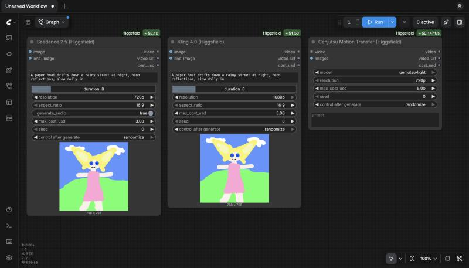

# ComfyUI-Higgsfield: Seedance 2.5, Kling 4.0 and Genjutsu nodes for ComfyUI

ComfyUI custom nodes for the [Higgsfield API](https://docs.higgsfield.ai). They generate AI video in [ComfyUI](https://github.com/comfyanonymous/ComfyUI) with **Seedance 2.5**, **Kling 4.0** and **Genjutsu motion transfer** (character swap). Each node shows the price before you run it. You pay Higgsfield directly in USD with your own API key, so you need no comfy.org account or credits.



| Node | What it does | Price per second (720p / 1080p) |
|---|---|---|
| **Seedance 2.5 (Higgsfield)** | Text-to-video, or image-to-video with first and last frames. 4–30 s, generated audio. | $0.2647 / $0.6518 (480p $0.1177) |
| **Kling 4.0 (Higgsfield)** | Text-to-video, or image-to-video with first and last frames. 3–30 s. | $0.1257 / $0.1879 |
| **Genjutsu Motion Transfer (Higgsfield)** | Puts the people from 1–8 reference images into a source video's motion. | Genjutsu $0.3446 / $0.8346, Light $0.1471 / $0.2936 |

List prices were checked 2026-11-19. Genjutsu bills the length of the source video, up to 30 s. Genjutsu Light bills the length of the output, up to 15 s.

## Price before you run

Each node shows its list price on a badge, and the badge updates as you change duration and resolution. A small frontend extension draws the badge from `web/rates.json`.

When the node runs, it first asks Higgsfield's free `/estimate` endpoint for the exact price of that request. If the price is above the node's `max_cost_usd`, the node stops before anything is submitted, and you are not charged.

Other safeguards:

- Every submission carries an `Idempotency-Key`, so a retry after a busy slot or a server error never pays twice.
- Pressing Cancel in ComfyUI cancels the request on Higgsfield while it is still queued. A canceled queued request is refunded.
- Higgsfield does not charge for failed or moderated (`nsfw`) requests.

## Install

With ComfyUI-Manager, install from the Git URL `https://github.com/jutsuhq/ComfyUI-Higgsfield`. To install by hand:

```bash
cd ComfyUI/custom_nodes
git clone https://github.com/jutsuhq/ComfyUI-Higgsfield
```

Then restart ComfyUI. The pack needs no extra Python packages; it uses only the Python standard library and what ComfyUI already ships. It needs a recent ComfyUI with the V3 node API (`comfy_api.latest`).

## API key

Create a key under API keys in [console.higgsfield.ai](https://console.higgsfield.ai), then do one of these:

- Set `HF_KEY=KEY_ID:KEY_SECRET` before you start ComfyUI. `HF_API_KEY` with `HF_API_SECRET` also works.
- Paste `KEY_ID:KEY_SECRET` into `custom_nodes/ComfyUI-Higgsfield/higgsfield_key.txt`. Git ignores this file.

The key is never a node widget, because ComfyUI saves widget values into workflow files and into the metadata of every image and video it writes.

## Example workflows

`example_workflows/` has one workflow per node:

- [Kling 4.0 text-to-video](example_workflows/kling40_text_to_video.json)
- [Seedance 2.5 image-to-video](example_workflows/seedance25_image_to_video.json)
- [Genjutsu motion transfer](example_workflows/genjutsu_motion_transfer.json)

To open one, drag the file onto the ComfyUI canvas, or open it from the template browser.

## Outputs

Each node returns:

- `video`, for Save Video or any node that takes video.
- `video_url`, the file on Higgsfield's CDN. Higgsfield keeps it for 7 days.
- `cost_usd`, the estimated price of the run.

`seed` is not sent to Higgsfield. Change it to run the same settings again.

Higgsfield stores the inputs you upload (images and source video) and deletes them within 7 days.

## FAQ

### Is there a Higgsfield node for ComfyUI?

Yes, this pack. It adds Seedance 2.5, Kling 4.0, Genjutsu and Genjutsu Light nodes that call the Higgsfield API with your own key. ComfyUI also ships a built-in Genjutsu motion transfer node that is billed through comfy.org credits.

### How is this different from ComfyUI's built-in Higgsfield node?

The built-in node covers full Genjutsu only. It needs a comfy.org sign-in and is billed in comfy.org credits, at $0.97 per second for 720p.

This pack calls Higgsfield directly, so 720p Genjutsu costs $0.3446 per second. It also adds Genjutsu Light, Seedance 2.5 and Kling 4.0.

### How do I use Seedance 2.5 in ComfyUI?

1. Install this pack and set your Higgsfield key.
2. Add **Seedance 2.5 (Higgsfield)** and connect its `video` output to **Save Video**.
3. For image-to-video, connect a **Load Image** to `image`.

[seedance25_image_to_video.json](example_workflows/seedance25_image_to_video.json) is a ready-made workflow.

### How do I use Kling 4.0 in ComfyUI?

Add **Kling 4.0 (Higgsfield)**, write a prompt and connect `video` to **Save Video**. Or start from [kling40_text_to_video.json](example_workflows/kling40_text_to_video.json).

### Can I swap a character in a video in ComfyUI?

Yes, with **Genjutsu Motion Transfer (Higgsfield)**:

1. Connect a source video of at least 4 seconds, from **Load Video**.
2. Connect 1 to 8 reference images.
3. Pick `genjutsu-light` for the cheaper model, which keeps the source audio.

### How much does a run cost?

The badge on each node shows the list price. For example, a 5-second Kling 4.0 clip at 1080p is about $0.94.

Before every run, the node checks the exact price with Higgsfield's estimate and never spends more than `max_cost_usd`.

## Tests

```bash
python -m unittest discover -s tests
```

## Related

- [Jutsu Studio](https://jutsustudio.com) is a desktop app for the same Higgsfield models. It adds a queue, a library and price checks on every run.
- [higgsfield-seedance-prompt-skill](https://github.com/jutsuhq/higgsfield-seedance-prompt-skill) is a Claude Code skill that writes Seedance 2.5 prompts.
- [open-source-higgsfield](https://github.com/jutsuhq/open-source-higgsfield) lists open-source projects built around Higgsfield.

## License

MIT
